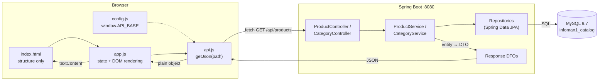
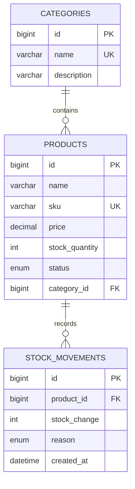

# Week 13 — F1: Connected Foundation

Connecting the existing Spring Boot product API to MySQL and to a vanilla
HTML/CSS/JavaScript read interface, without changing the API contract that
already worked at the midterm checkpoint.

- **Branch:** `week13` (created from `midterm`)
- **Application root:** repository root — `pom.xml`, `mvnw.cmd` and the frontend
  in `src/main/resources/static/` all live at the top level
- **Database:** MySQL 9.7.2, schema `infoman1_catalog`

---

## 1. Baseline audit — what already worked before this week

The midterm project was already a working Spring Boot API. Week 13 did not
rebuild any of it; it changed where the data lives and added a browser in front
of it.

| Layer | Artifact | State at start of week 13 |
| --- | --- | --- |
| Domain model | `Category`, `Product`, `ProductStatus` | Working |
| Persistence | `CategoryRepository`, `ProductRepository` (Spring Data JPA) | Working |
| Business rules | `CategoryService`, `ProductService` | Working, `@Transactional` |
| Request/response shapes | `ProductRequestDTO`, `ProductResponseDTO`, `CategoryRequestDTO`, `CategoryResponseDTO` | Working |
| HTTP layer | `ProductController`, `CategoryController` | Working |
| Validation | `jakarta.validation` annotations on request DTOs | Working |
| Error contract | `GlobalExceptionHandler`, `ErrorResponse` | Working — 400 / 404 / 409 / 500 |
| Pagination | `Pageable` with a 100-row cap in `ProductController` | Working |
| Contract tests | `docs/product-catalog.postman_collection.json` | 22 requests, 51 assertions |
| Persistence target | **H2 in-memory** | Wrong for the finals |
| Frontend | none | Missing |
| Third domain table | none | Missing |

Three gaps, therefore: persistence, a third related table, and the read
interface. Everything else was carried forward unchanged.

---

## 2. What changed this week

1. **Persistence moved from H2 to MySQL.** `mysql-connector-j` replaced the
   runtime H2 dependency; H2 is now `test` scope only. Credentials come from
   `DB_URL` / `DB_USER` / `DB_PASSWORD` environment variables with
   `application.properties.example` documenting the shape.
2. **A third related table, `stock_movements`,** was added so the schema has
   three related domain tables. The entity and its enum exist; there is no
   endpoint for it yet — that is week 14's atomic workflow.
3. **Seed data** (`docs/week13/seed.sql`) — 3 categories, 8 products, 13 stock
   movements, with every product's `stock_quantity` equal to the sum of its
   ledger rows.
4. **A vanilla frontend** in `src/main/resources/static/` served by Spring Boot
   from the same origin as the API.

Deliberately unchanged: every URL, request shape, response shape and status
code. The Postman collection was re-run after the migration to prove it.

---

## 3. Architecture and data flow



The three boundaries this diagram is making explicit:

- **Browser → API** is HTTP + JSON. The browser never sees a `Product` entity
  and never touches MySQL.
- **Controller → Service → Repository** stays intact. The controller only
  translates HTTP to method calls; business rules and transaction boundaries
  live in the service.
- **Entity → DTO** happens inside the service, so lazy associations are resolved
  while the session is still open.

### Data model



`stock_movements.stock_change` is signed: `+50` is a restock, `-3` is a sale, so
`SUM(stock_change)` per product equals the cached `products.stock_quantity`.
That relationship is what makes the table useful rather than decorative, and it
is the two-record workflow week 14 will implement atomically.

### Request flow for the list view

1. `app.js` builds `/api/products?page=0&size=5&categoryId=2`.
2. `api.js` calls `fetch` and rejects non-2xx responses as `ApiError`.
3. `ProductController.getAll` caps the page size at 100 and delegates.
4. `ProductService.findAll` picks `findAll` or `findByCategoryId`, maps entities
   to `ProductResponseDTO`, and returns a `Page`.
5. Jackson serialises the `Page` — rows are in `content`, not at the top level.
6. `app.js` reads `page.content`, renders rows, and drives the pager from
   `page.number` / `page.totalPages`.

---

## 4. Endpoint contract table

Preserved from the midterm; the frontend depends on exactly these shapes.

| Method | Path | Parameters | Success | Errors |
| --- | --- | --- | --- | --- |
| GET | `/api/products` | `page`, `size` (≤100), `sort`, `categoryId` (optional) | `200` `Page<ProductResponseDTO>` | `400` invalid page/size/sort |
| GET | `/api/products/{id}` | path id | `200` `ProductResponseDTO` | `404` not found, `400` non-numeric id |
| POST | `/api/products` | JSON `ProductRequestDTO` | `201` + `Location`, body `ProductResponseDTO` | `400` validation, `404` unknown `categoryId`, `409` duplicate SKU |
| PUT | `/api/products/{id}` | path id + JSON body | `200` `ProductResponseDTO` | `400`, `404`, `409` |
| DELETE | `/api/products/{id}` | path id | `204` | `404` |
| GET | `/api/categories` | none | `200` **raw array** of `CategoryResponseDTO` | — |
| GET | `/api/categories/{id}` | path id | `200` `CategoryResponseDTO` | `404` |
| POST | `/api/categories` | JSON `CategoryRequestDTO` | `201` + `Location` | `400`, `409` duplicate name |
| PUT | `/api/categories/{id}` | path id + JSON body | `200` | `400`, `404`, `409` |
| DELETE | `/api/categories/{id}` | path id | `204` | `404`, `409` category still has products |

Response shapes:

```json
// ProductResponseDTO
{ "id": 6, "name": "Ergonomic Chair", "sku": "SKU-2003", "price": 249.00,
  "stockQuantity": 5, "status": "ACTIVE", "categoryId": 2, "categoryName": "Office" }

// ErrorResponse
{ "status": 404, "message": "Product not found with id: 9999",
  "timestamp": "2026-11-28T12:08:32Z", "errors": null }
```

### Why `page.content` matters

`GET /api/products` returns a Spring `Page`, not an array:

```json
{
  "content": [ { "id": 1, "name": "Wireless Mouse", "...": "..." } ],
  "empty": false,
  "first": true,
  "last": false,
  "number": 0,
  "size": 5,
  "totalElements": 8,
  "totalPages": 2
}
```

A client that does `for (const p of response)` renders nothing, because
`response` is an object. `app.js` therefore reads `page.content` and guards it:

```js
const rows = page.content;
if (!Array.isArray(rows)) throw new Error("Unexpected list response");
```

`GET /api/categories` is the opposite case — a raw array — so it is parsed
directly. Two endpoints on the same API with different top-level shapes is
normal; the contract table records which is which instead of assuming.

### Empty is not an error

A list request that matches nothing returns `200` with `"content": []` and
`"totalPages": 0`, not `404`. The frontend treats that as an empty state
("No products match this filter.") and renders no rows. `404` is reserved for a
missing individual record.

---

## 5. Origins and CORS

An **origin** is scheme + host + port. `http://localhost:5500` and
`http://localhost:8080` are different origins even though both are on the same
machine, because the ports differ.

The browser only allows a cross-origin `fetch` when the server answers with a
matching `Access-Control-Allow-Origin` header. That is CORS: a browser access
policy, enforced by the browser, not by the server and not by any login system.

**This project avoids the problem instead of configuring around it.** Spring
Boot serves `src/main/resources/static/index.html` at `http://localhost:8080/`,
and the API is at `http://localhost:8080/api/...`. Same scheme, same host, same
port — same origin, so there is no preflight and no CORS header anywhere in the
project.

The API base is still a setting rather than a hardcoded string:

```js
// js/config.js
window.API_BASE = "";
```

Empty means "same origin". If the frontend were later served from a separate dev
server, the change is one line plus a backend `@CrossOrigin` (or
`CorsConfigurationSource`) limited to that exact origin — never `*`, and never
`mode: "no-cors"`, which returns an opaque response whose body cannot be read.

Two things CORS is not:

- **Not authentication.** It does not stop `curl`, a script, or any non-browser
  client from calling the API.
- **Not authorisation.** It does not decide what a user may do. That is week 15.

A related detail: browser-delivered configuration is public. Anything in
`config.js` is readable in DevTools, which is why the database password lives in
the server's environment variables and never in frontend code.

---

## 6. DTO boundaries

The entity is never serialised to JSON. `ProductService` maps it explicitly:

```java
private static ProductResponseDTO toResponse(Product product) {
    return new ProductResponseDTO(
            product.getId(),
            product.getName(),
            product.getSku(),
            product.getPrice(),
            product.getStockQuantity(),
            product.getStatus(),
            product.getCategory().getId(),
            product.getCategory().getName());
}
```

Three reasons this matters here:

1. **Lazy loading.** `Product.category` is `FetchType.LAZY`. With
   `spring.jpa.open-in-view=false`, serialising the entity after the service
   transaction closes would throw `LazyInitializationException`. Mapping inside
   the transaction resolves `category.getName()` while the session is open.
2. **Shape control.** The frontend needs `categoryName`, which is not a column
   on `products` — it is a value pulled through the relationship. The DTO
   decides that the list row shows the category name instead of a bare id.
3. **No entity graph leakage.** A `@ManyToOne` back-reference, or a future
   `@OneToMany` of stock movements, would appear in the JSON and could recurse.
   The DTO exposes exactly the eight fields the contract table lists.

The same rule is why `StockMovement` has **no** `@OneToMany` collection on
`Product`: nothing needs to serialise it, so nothing can leak.

---

## 7. One real DevTools diagnosis

**Symptom.** Typing `9999` into "Load by product ID" and pressing **Load** shows
"No product exists with ID 9999." in amber. Is that the browser failing, or the
server?

**Investigation.** DevTools → Network, filter `Fetch/XHR`, then Load:

```
Name                      Status   Type   Initiator
9999                      404      fetch  api.js:20
```

Request: `GET http://localhost:8080/api/products/9999` — no preflight `OPTIONS`,
because the request is same-origin.

Response headers: `Content-Type: application/json`.

Response body:

```json
{"status":404,"message":"Product not found with id: 9999","errors":null,"timestamp":"..."}
```

**Reading it.** The row is not red-broken and the body is valid JSON, so this is
not a connection failure and not a CORS block. `404` with an
application-generated message means the request reached Spring, matched
`@GetMapping("/{id}")`, and `ResourceNotFoundException` was translated by
`GlobalExceptionHandler`. The database answered "no such row". So the defect, if
any, is not in the network layer — the record genuinely does not exist.

**Why the UI says something different from a generic failure.** `fetch` only
rejects when no response arrives. An HTTP `404` is a *successful* transport
carrying an error status, so `api.js` checks `response.ok` and throws an
`ApiError` that keeps the status:

```js
if (!response.ok) {
  throw new ApiError(detail || `Request failed (${response.status})`, response.status);
}
```

`app.js` then branches on it:

```js
if (error instanceof ApiError && error.status === 404) {
  setDetailStatus(`No product exists with ID ${id}.`, "not-found");
} else {
  setDetailStatus(describe(error), "error");
}
```

That is the difference the screenshot shows: a 404 gets the specific
"no product exists" message, while a stopped server gets "Cannot reach the
server. Is the Spring Boot app running?" — and only the second one shows the
**Retry** button, because retrying a 404 for a fixed id can never succeed.

Evidence: `docs/week13/evidence/06-not-found.png`.

---

## 8. Evidence index

| File | Shows |
| --- | --- |
| `evidence/01-list.png` | product list, "Showing 5 of 8 products.", Page 1 of 2 |
| `evidence/02-detail.png` | detail panel loaded from `GET /api/products/1` |
| `evidence/03-network.png` | Network → Response tab showing the `content` array |
| `evidence/04-sql-crosscheck.png` | MySQL row for id 6 beside the API JSON for id 6 |
| `evidence/05-empty.png` | Office filter with zero products, "No products match this filter." |
| `evidence/06-not-found.png` | 404 result for id 9999 |

---

## 9. Limitations of this milestone

- The browser is **read-only**. No create/edit/delete forms — week 14.
- `stock_movements` has a table and an entity but no HTTP surface yet.
- No authentication or authorisation — week 15.
- `ddl-auto=update` is convenient for coursework but is not a migration
  strategy; a real deployment would use versioned migrations.
- The Postman collection assumes an empty catalog, because it creates fixed
  names and deletes fixed ids. `docs/week13/reset.sql` documents the required
  starting state.
