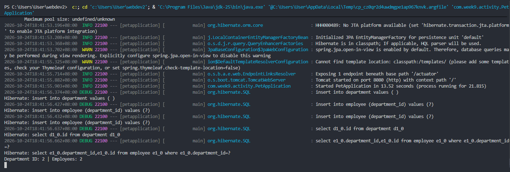
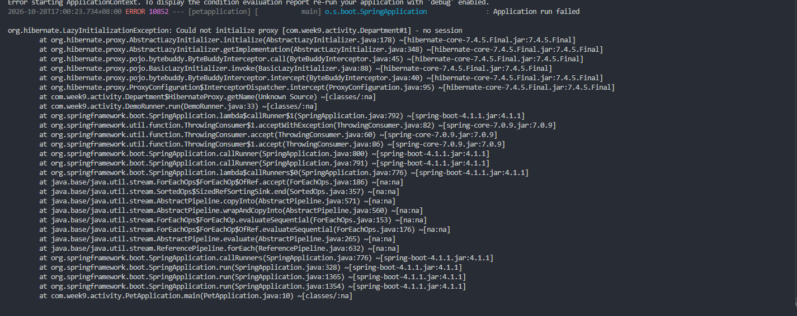
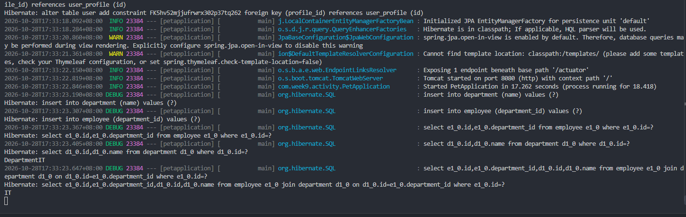
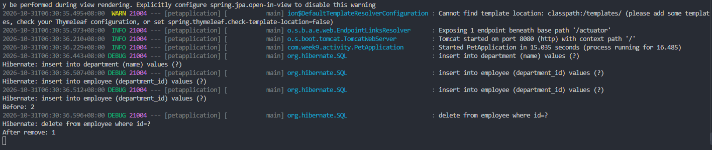
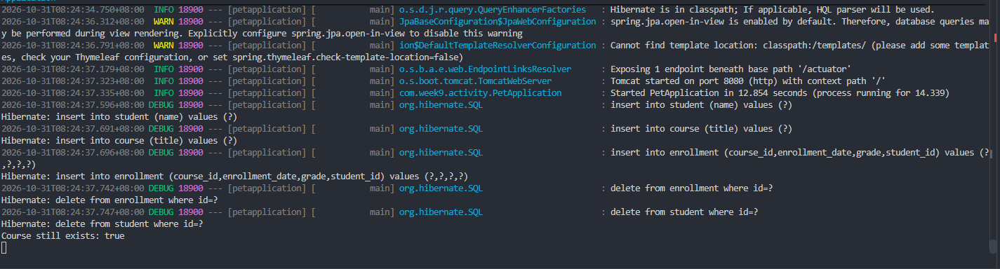
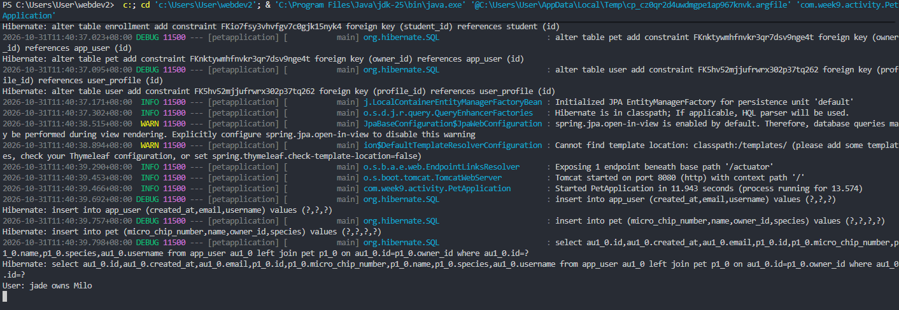

# WEBDEV2 — Week 9 Lab Answers

Name: Jade Roland Eduard C Pinon
Student ID: 2511036
GitHub repo: <https://github.com/arcticWulf123/webdev2>
Date submitted:

---

## Task 1 — One-to-One + One-to-Many Mappings

**Approach / explanation:**
I set the owning sides by giving them the @JoinColumn annotation, I applied these on the Employee and the User class. While on the other hand, I used the mappedBy annotation to UserProfile and Department classes, I also added the helper methods in the Department class such as addEmployee(), removeEmployee() and findAll().

**Code / endpoint(s) used (if applicable):**

```java
@Entity
public class User {
    @Id
    @GeneratedValue(strategy = GenerationType.IDENTITY)
    private Long id;

    @OneToOne
    @JoinColumn(name = "profile_id")
    private UserProfile profile;
}

@Entity
public class UserProfile {
    @Id
    @GeneratedValue(strategy = GenerationType.IDENTITY)
    private Long id;

    @OneToOne(mappedBy = "profile")
    private User user;
}

@Entity
public class Department {
    @Id
    @GeneratedValue(strategy = GenerationType.IDENTITY)
    private Long id;

    public Long getId() {
        return id;
    }

    public void setId(Long id) {
        this.id = id;
    }

    @OneToMany(mappedBy = "department", cascade = CascadeType.ALL, orphanRemoval = true)
    private List<Employee> employees = new ArrayList<>();

    public List<Employee> getEmployees() {
        return employees;
    }

    public void setEmployees(List<Employee> employees) {
        this.employees = employees;
    }

    public void addEmployee(Employee employee) {
        employees.add(employee);
        employee.setDepartment(this);
    }

    public void removeEmployee(Employee employee) {
        employees.remove(employee);
        employee.setDepartment(null);
    }
}

@Entity
public class Employee {
    @Id
    @GeneratedValue(strategy = GenerationType.IDENTITY)
    private Long id;

    public Employee(Long id, Department department) {
        this.id = id;
        this.department = department;
    }

    public Employee() {
    }

    public Long getId() {
        return id;
    }

    public void setId(Long id) {
        this.id = id;
    }

    @ManyToOne(fetch = FetchType.LAZY)
    @JoinColumn(name = "department_id", nullable = false)
    private Department department;

    public Department getDepartment() {
        return department;
    }

    public void setDepartment(Department department) {
        this.department = department;
    }
}
```

**Evidence (screenshot filename, request/response sample, or file reference in this folder):**


**Reflection question:**
_Which entity owns the `Department`–`Employee` relationship and why, and what value must `mappedBy` contain?_

Your answer:
The employee is the owner in the relationship between Employee - Department. The many side is the Employee, the many side always acts as the owning side in a Many to One and One to Many relationships. mappedBy must contain the value "Department".

---

## Task 2 — Many-to-Many Join Table + Association Entity

**Approach / explanation:**
I first used @ManyToMany with a join table, then switched to an Enrollment entity to store extra fields like enrollmentDate and grade. I added a unique constraint on (student_id, course_id) and tested duplicate rejection by using saveAndFlush() and catching DataIntegrityViolationException.

**Code / endpoint(s) used (if applicable):**

```java
@Entity
public class Student {

  public Student(Long id, String name) {
    this.id = id;
    this.name = name;
  }

  public Student () {}

  @Id
  @GeneratedValue(strategy = GenerationType.IDENTITY)
  private Long id;

  private String name;

  public Long getId() {
    return id;
  }

  public void setId(Long id) {
    this.id = id;
  }

  public String getName() {
    return name;
  }

  public void setName(String name) {
    this.name = name;
  }

  @OneToMany(mappedBy = "student", cascade = CascadeType.ALL, orphanRemoval = true)
  private List<Enrollment> enrollments = new ArrayList<>();

  public void addEnrollment(Enrollment enrollment) {
    enrollments.add(enrollment);
    enrollment.setStudent(this);
  }

  public void removeEnrollment(Enrollment enrollment) {
    enrollments.remove(enrollment);
    enrollment.setStudent(null);
  }

  public List<Enrollment> getEnrollments() {
    return enrollments;
  }
}

@Entity
public class Course {
    @Id
    @GeneratedValue(strategy = GenerationType.IDENTITY)
    private Long id;

    private String title;

    public String getTitle() {
        return title;
    }

    public void setTitle(String title) {
        this.title = title;
    }

     @OneToMany(mappedBy = "course", cascade = CascadeType.ALL, orphanRemoval = true)
  private List<Enrollment> enrollments = new ArrayList<>();

  public void addEnrollment(Enrollment enrollment) {
    enrollments.add(enrollment);
    enrollment.setCourse(this);
  }

  public void removeEnrollment(Enrollment enrollment) {
    enrollments.remove(enrollment);
    enrollment.setStudent(null);
  }

  public List<Enrollment> getEnrollments() {
    return enrollments;
  }
}


@Entity
@Table(name = "enrollment", uniqueConstraints = @UniqueConstraint(name = "uk_student_course", columnNames = {
        "student_id", "course_id" }))
public class Enrollment {
    @Id
    @GeneratedValue(strategy = GenerationType.IDENTITY)
    private Long id;

    public Long getId() {
        return id;
    }

    public void setId(Long id) {
        this.id = id;
    }

    @ManyToOne
    @JoinColumn(name = "student_id", nullable = false)
    private Student student;

    public Student getStudent() {
        return student;
    }

    public void setStudent(Student student) {
        this.student = student;
    }

    @ManyToOne
    @JoinColumn(name = "course_id", nullable = false)
    private Course course;

    public Course getCourse() {
        return course;
    }

    public void setCourse(Course course) {
        this.course = course;
    }

    private LocalDate enrollmentDate;
    private String grade;

    public LocalDate getEnrollmentDate() {
        return enrollmentDate;
    }

    public void setEnrollmentDate(LocalDate enrollmentDate) {
        this.enrollmentDate = enrollmentDate;
    }

    public String getGrade() {
        return grade;
    }

    public void setGrade(String grade) {
        this.grade = grade;
    }

    public Enrollment() {
    }

    public Enrollment(Student student, Course course, LocalDate enrollmentDate, String grade) {
        this.student = student;
        this.course = course;
        this.enrollmentDate = enrollmentDate;
        this.grade = grade;
    }

}

```

**Evidence (screenshot filename, request/response sample, or file reference in this folder):**

**Reflection question:**
_When must a many-to-many relationship be modeled as an association entity instead of a direct `@ManyToMany`, and what did the unique constraint protect in your test?_

Your answer:
A many-to-many relationship must be modeled as an association entity if you need to add fields in a relationship. Adding the unique constraints to student_id and course_id prevents the same student from enrolling in the same course twice, protecting the database from duplicate entries.

---

## Task 3 — Fetch Strategies Experiment — LAZY vs EAGER

**Approach / explanation:**
I set Employee.department to FetchType.LAZY and reproduced the LazyInitializationException by loading an Employee through a non-transactional EmployeeService method, then accessing e.getDepartment().getName() outside of a transaction. To fix this, I tried two approaches: first, I moved the access inside a @Transactional(readOnly = true) method so the Hibernate session stayed open, and second, I used a JOIN FETCH query in my EmployeeRepository to load both the Employee and Department in a single query. I then compared the number of SQL queries between all three cases.

**Code / endpoint(s) used (if applicable):**

```java
@Entity
public class Employee {
    @Id
    @GeneratedValue(strategy = GenerationType.IDENTITY)
    private Long id;

    public Employee(Long id, Department department) {
        this.id = id;
        this.department = department;
    }

    public Employee() {
    }

    public Long getId() {
        return id;
    }

    public void setId(Long id) {
        this.id = id;
    }

    @ManyToOne(fetch = FetchType.LAZY)
    @JoinColumn(name = "department_id", nullable = false)
    private Department department;

    public Department getDepartment() {
        return department;
    }

    public void setDepartment(Department department) {
        this.department = department;
    }
}

@Service
public class EmployeeService {

    private final EmployeeRepository employeeRepository;

    public EmployeeService(EmployeeRepository employeeRepository) {
        this.employeeRepository = employeeRepository;
    }

    public Employee getEmployee(Long id) {
        return employeeRepository.findById(id).orElseThrow();
    }

    @Transactional(readOnly = true)
    public String getDepartmentName(Long id) {
        Employee e = employeeRepository.findById(id).orElseThrow();
        return e.getDepartment().getName();
    }

    public Employee getEmployeeWithDepartment(Long id) {
        return employeeRepository.findByIdwithDepartment(id).orElseThrow();
    }
}

public interface EmployeeRepository extends JpaRepository<Employee,Long> {
    
    @Query("SELECT e FROM Employee e JOIN FETCH e.department WHERE e.id = :id")
    Optional<Employee> findByIdwithDepartment(@Param("id") Long id);
} 
```

**Evidence (screenshot filename, request/response sample, or file reference in this folder):**



**Reflection question:**
_What causes `LazyInitializationException`, and why is prefer-LAZY plus explicit fetch join/`@EntityGraph` preferable to marking everything EAGER?_

Your answer:
A LazyInitializationException happens when you try to access a lazily loaded proxy after the Hibernate session or transaction has been closed. Since the proxy was never initialized, Hibernate has no way to fetch it anymore. It's better to keep relationships as LAZY by default because making them EAGER loads all related data right away, which can lead to the N+1 problem and pull in way more data than needed. Using @Transactional or a fetch join lets us load exactly what we need, at the right time, while still keeping good performance.

---

## Task 4 — Cascade + orphanRemoval — Safe vs. Dangerous

**Approach / explanation:**
For Task 4, I treated Department and Employee as a composition, so I set Department.employees to cascade = {CascadeType.PERSIST, CascadeType.MERGE} with orphanRemoval = true. This allowed me to save new employees through the department and delete an employee by simply removing it from the collection. For the shared case, Student and Course are linked through Enrollment. I only added cascade = {CascadeType.PERSIST, CascadeType.MERGE}, orphanRemoval = true to Student.enrollments, while leaving Course.enrollments with no cascade at all. This way, deleting a Student would only remove its Enrollment, but the shared Course would remain untouched.

**Code / endpoint(s) used (if applicable):**

```java
// Department.java (Safe Composition)
@Entity 
public class Department {
    @Id
    @GeneratedValue(strategy = GenerationType.IDENTITY)
    private Long id;
    
    private String name;

    @OneToMany(mappedBy = "department", cascade = {CascadeType.PERSIST, CascadeType.MERGE}, orphanRemoval = true)
    private List<Employee> employees = new ArrayList<>();

    public void addEmployee(Employee employee) {
        employees.add(employee);
        employee.setDepartment(this);
    }

    public void removeEmployee(Employee employee) {
        employees.remove(employee);
        employee.setDepartment(null);
    }
}

// Student.java (Safe for this test)
@Entity
public class Student {
    @Id
    @GeneratedValue(strategy = GenerationType.IDENTITY)
    private Long id;

    private String name;

    @OneToMany(mappedBy = "student", cascade = {CascadeType.PERSIST, CascadeType.MERGE}, orphanRemoval = true)
    private List<Enrollment> enrollments = new ArrayList<>();

    public void addEnrollment(Enrollment enrollment) {
        enrollments.add(enrollment);
        enrollment.setStudent(this);
    }
}

// Course.java (Shared Entity - NO Cascade)
@Entity 
public class Course {
    @Id 
    @GeneratedValue(strategy = GenerationType.IDENTITY)
    private Long id;

    private String title;

    @OneToMany(mappedBy = "course")
    private List<Enrollment> enrollments = new ArrayList<>(); 

    public void addEnrollment(Enrollment enrollment) {
        enrollments.add(enrollment);
        enrollment.setCourse(this);
    }

    public void removeEnrollment(Enrollment enrollment) {
        enrollments.remove(enrollment);
        enrollment.setCourse(null);
    }
}
// DemoRunner.java (Shared Case Test)
@Transactional
@Override
public void run(String... args) {
    Student s = new Student();
    s.setName("Alice");
    studentRepository.save(s);

    Course c = new Course();
    c.setTitle("WebDev");
    courseRepository.save(c);

    Enrollment en = new Enrollment(s, c, LocalDate.now(), "A");
    s.addEnrollment(en);
    c.addEnrollment(en);
    enrollmentRepository.saveAndFlush(en);

    Long courseId = c.getId();

    studentRepository.delete(s);
    entityManager.flush();

    boolean courseExists = courseRepository.findById(courseId).isPresent();
    System.out.println("Course still exists: " + courseExists);
}
```

**Evidence (screenshot filename, request/response sample, or file reference in this folder):**



**Reflection question:**
_What is the difference between `CascadeType.REMOVE` and `orphanRemoval = true`, and in which situation is each appropriate or dangerous?_

Your answer:
CascadeType.REMOVE deletes child entities when the parent is deleted. On the other hand, orphanRemoval = true deletes child entities when they are removed from the parent's collection, even if the parent still exists. orphanRemoval = true is ideal for composition cases like Department–Employee, where the child has no reason to exist without its parent. However, using CascadeType.REMOVE or CascadeType.ALL on shared entities like Student–Course is dangerous, since deleting one student could end up deleting a course that other students still rely on. In short, only cascade deletes when the child is fully owned by that parent.

---

## Task 5 — Capstone Milestone 2 — ERD to JPA Entity Model

**Approach / explanation:**
For Task 5, I modeled `AppUser` and `Pet` as a 1:1 relationship based on my capstone ERD. I made `Pet` the owning side by adding `@OneToOne(fetch = FetchType.LAZY)` with `@JoinColumn(name = "owner_id", unique = true)`, while `AppUser` was the inverse side with `@OneToOne(mappedBy = "owner", fetch = FetchType.LAZY, cascade = {CascadeType.PERSIST, CascadeType.MERGE})`. I added `AppUserRepository` and `PetRepository`, and used a `@Transactional` `CommandLineRunner` to save and read back the object graph to verify the mapping worked.

**Code / endpoint(s) used (if applicable):**

```java
@Entity
public class Pet {
    @Id
    @GeneratedValue(strategy = GenerationType.IDENTITY)
    private Long id;
    public Long getId() {
        return id;
    }

    public void setId(Long id) {
        this.id = id;
    }

    private String microChipNumber;
    private String name;
    private String species;
    
    @OneToOne(fetch = FetchType.LAZY)
    @JoinColumn(name = "owner_id", unique = true)
    private AppUser owner;

    public Pet(String microChipNumber, String name, String species, AppUser owner) {
        this.microChipNumber = microChipNumber;
        this.name = name;
        this.species = species;
        this.owner = owner;
    }

    public Pet() {
    }

    public AppUser getOwner() {
        return owner;
    }

    public void setOwner(AppUser owner) {
        this.owner = owner;
    }

    public String getMicroChipNumber() {
        return microChipNumber;
    }

    public void setMicroChipNumber(String microChipNumber) {
        this.microChipNumber = microChipNumber;
    }

    public String getName() {
        return name;
    }

    public void setName(String name) {
        this.name = name;
    }

    public String getSpecies() {
        return species;
    }

    public void setSpecies(String species) {
        this.species = species;
    }

}

public interface PetRepository extends JpaRepository<Pet, Long>{
    
}

@Entity
@Table(name = "app_user")
public class AppUser {
    @Id
    @GeneratedValue(strategy = GenerationType.IDENTITY)
    private Long id;
    public Long getId() {
        return id;
    }

    public void setId(Long id) {
        this.id = id;
    }

    private LocalDate createdAt;
    private String username;
    private String email;
    @OneToOne(mappedBy = "owner", fetch = FetchType.LAZY, cascade = { CascadeType.PERSIST, CascadeType.MERGE })
    private Pet pet;

    public AppUser(LocalDate createdAt, String username, String email, Pet pet) {
        this.createdAt = createdAt;
        this.username = username;
        this.email = email;
        this.pet = pet;
    }

    public AppUser(){}

    public LocalDate getCreatedAt() {
        return createdAt;
    }

    public void setCreatedAt(LocalDate createdAt) {
        this.createdAt = createdAt;
    }

    public String getUsername() {
        return username;
    }

    public void setUsername(String username) {
        this.username = username;
    }

    public String getEmail() {
        return email;
    }

    public void setEmail(String email) {
        this.email = email;
    }

    public Pet getPet() {
        return pet;
    }

    public void setPet(Pet pet) {
        this.pet = pet;
    }
}

public interface  AppUserRepository extends JpaRepository<AppUser, Long> {
    
}

 @Override
    @Transactional
    public void run(String... args) {
        // Create the user first
        AppUser user = new AppUser(LocalDate.now(), "jade", "jade@example.com", null);
        appUserRepository.save(user);

        // Create the pet and link to the user
        Pet pet = new Pet("000123456789012", "Milo", "Dog", user);
        user.setPet(pet);
        petRepository.save(pet);
        appUserRepository.save(user);

        entityManager.flush();
        entityManager.clear();

        // Read back to prove the 1:1 link works
        AppUser loadedUser = appUserRepository.findById(user.getId()).orElseThrow();
        System.out.println("User: " + loadedUser.getUsername() + " owns " + loadedUser.getPet().getName());
    }
```

**Evidence (screenshot filename, request/response sample, or file reference in this folder):**


**Reflection question:**
_For one relationship in your capstone model, state the cardinality, the owning side, where the FK/join table lives, and why you chose that fetch and cascade setting._

Your answer:
For the AppUser–Pet relationship, the cardinality is 1:1. Pet is the owning side since it holds the foreign key owner_id via @JoinColumn(name = "owner_id", unique = true), so the FK lives in the pet table. AppUser is the inverse side with mappedBy = "owner". I set both sides to FetchType.LAZY to avoid loading the related entity unless it's actually accessed. For cascade, I only added CascadeType.PERSIST and CascadeType.MERGE on AppUser.pet so I could persist them together if needed, but I avoided CascadeType.REMOVE or CascadeType.ALL since a Pet should not be deleted just because its AppUser is removed. The unique = true on owner_id also enforces a true 1:1 instead of allowing a 1:N.

---

## Self-Check

- [ ] All Week 9 work on the `week9` branch (project at branch root, no `week9/` folder)
- [ ] This file completed and renamed `answers.md`
- [ ] Repository link pasted into Moodle (no files uploaded)
