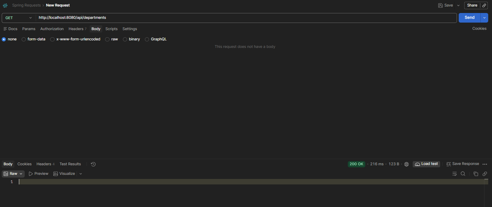

# WEBDEV2 — Week 10 Lab Answers

Name: Jade Roland Eduard C. Pinon
Student ID: 2511036
GitHub repo: <https://github.com/arcticWulf123/webdev2>
Date submitted: 11/17/2026

---

## Task 1 — URL Design & Controller Skeleton

**URL design table (method, path, expected status codes):**

| HTTP Method | URL Path | Expected Status Codes |
| --- | --- | --- |
| GET | `/api/departments` | `200` |
| GET | `/api/departments/{id}` | `200`, `404` |
| POST | `/api/departments` | `201`, `400` |
| PUT | `/api/departments/{id}` | `200`, `404`, `400` |
| PATCH | `/api/departments/{id}` | `200`, `404`, `400` |
| DELETE | `/api/departments/{id}` | `204`, `404` |

**Controller skeleton code:**

```java
@RestController
@RequestMapping("/api/departments")
public class DepartmentController {

    @GetMapping
    public ResponseEntity<?> getAllDepartments() {
        return ResponseEntity.ok().build();
    }

    @GetMapping("/{id}")
    public ResponseEntity<?> getDepartmentById(@PathVariable Long id) {
        return ResponseEntity.ok().build();
    }

    @PostMapping
    public ResponseEntity<?> createDepartment(@RequestBody Department department) {
        return ResponseEntity.status(HttpStatus.CREATED).build();
    }

    @PutMapping("/{id}")
    public ResponseEntity<?> updateDepartment(@PathVariable Long id, @RequestBody Department department) {
        return ResponseEntity.ok().build();
    }

    @PatchMapping("/{id}")
    public ResponseEntity<?> patchDepartment(@PathVariable Long id, @RequestBody Department department) {
        return ResponseEntity.ok().build();
    }

    @DeleteMapping("/{id}")
    public ResponseEntity<?> deleteDepartment(@PathVariable Long id) {
        return ResponseEntity.noContent().build();
    }
}
```

**Evidence (screenshot filename or curl output):**


**Reflection question:**
_Why do REST URLs use plural nouns (`/api/departments`) rather than verb phrases (`/api/getDepartments`), and what role does the HTTP method play?_

Your answer:
REST uses plural nouns to name the collection of resources, like `/api/departments`. A verb phrase like `/api/getDepartments` would describe an action instead of naming a resource. The HTTP method is the action verb: `GET` retrieves, `POST` creates, `PUT` replaces, `PATCH` partially updates, and `DELETE` removes.

---

## Task 2 — GET Endpoints — List & Get by ID

**Approach / explanation:**

I created a `DepartmentDTO` response class with only safe-to-expose fields (`id`, `name`) and added a `toDTO(Department)` mapping method in the service. The service’s `getAllDepartments()` method calls `departmentRepository.findAll()` and streams the results through `toDTO()` to return `List<DepartmentDTO>`. The `getDepartmentById(Long id)` method calls `departmentRepository.findById(id)`, maps the entity to a DTO via `toDTO()`, and returns `ResponseEntity.ok(dto)` when found or `ResponseEntity.notFound().build()` when the ID does not exist. The controller exposes `GET /api/departments` (200 with empty list `[]` if no records) and `GET /api/departments/{id}` (200 with DTO body, or 404 if not found).

**`DepartmentDTO` class code:**

```java
public class DepartmentDTO {
    private Long id;
    private String name;

    public DepartmentDTO() {
    }

    public DepartmentDTO(Long id, String name) {
        this.id = id;
        this.name = name;
    }

    public Long getId() {
        return id;
    }

    public void setId(Long id) {
        this.id = id;
    }

    public String getName() {
        return name;
    }

    public void setName(String name) {
        this.name = name;
    }

    public static DepartmentDTO from(Department department) {
        DepartmentDTO dto = new DepartmentDTO();
        dto.setId(department.getId());
        dto.setName(department.getName());
        return dto;
    }
}
```

**`toDTO()` mapping method code:**

```java
private DepartmentDTO toDTO(Department department) {
    DepartmentDTO dto = new DepartmentDTO();
    dto.setId(department.getId());
    dto.setName(department.getName());
    return dto;
}
```

**Evidence (screenshot filename or curl/Postman output):**

- `GET /api/departments`

```json
[]
```

- `GET /api/departments`

```json
[{"id":1,"name":"IT"}]
```

- `GET /api/departments/1`

```json
{"id":1,"name":"IT"}
```

- `GET /api/departments/999`

```json
{}
```

**Reflection question:**

_What would go wrong if you returned the JPA entity directly from `@GetMapping("/{id}")` instead of a DTO?_

Returning the JPA entity directly exposes internal persistence details (such as `GeneratedValue` strategies, `@Id` fields, entity relationships, or sensitive columns like passwords or timestamps) to the API consumer. It also couples the API contract to the database model — any change to the entity (adding a field, changing a type, etc.) would break the API client. A DTO acts as a boundary, exposing only the fields the client needs and keeping the internal model hidden.

---

## Task 3 — POST Endpoint — Create with 201 + Location

**Approach / explanation:**

I created a `CreateDepartmentRequest` DTO with only the required input field (`name`). The client sends this DTO in the POST body, the service maps it to a `Department` entity, persists it via the repository, and returns the saved department as a `DepartmentDTO`. The controller constructs a `Location` header using `ServletUriComponentsBuilder.fromCurrentRequest().path("/{id}").buildAndExpand(created.getId()).toUri()` so that the client can retrieve the newly created resource via `GET /api/departments/{id}`. The response returns `201 Created` with the DTO body and the `Location` header.

**`CreateDepartmentRequest` class code:**

```java
public class CreateDepartmentRequest {
    private String name;

    public CreateDepartmentRequest() {
    }

    public CreateDepartmentRequest(String name) {
        this.name = name;
    }

    public String getName() {
        return name;
    }

    public void setName(String name) {
        this.name = name;
    }
}
```

**Controller `create()` method code:**

```java
@PostMapping
public ResponseEntity<?> createDepartment(@RequestBody CreateDepartmentRequest request) {
    Department department = new Department();
    department.setName(request.getName());
    Department created = departmentService.createDepartment(department);

    Long newId = created.getId();
    var uri = ServletUriComponentsBuilder.fromCurrentRequest()
            .path("/{id}")
            .buildAndExpand(newId)
            .toUri();

    DepartmentDTO dto = DepartmentDTO.from(created);
    return ResponseEntity.created(uri).body(dto);
}
```

**Evidence (screenshot filename or curl/Postman output):**

- `POST /api/departments` → `201 Created` with body `{"id":1,"name":"HR"}` and `Location: http://localhost:8080/api/departments/1` (when department is successfully created)
- `POST /api/departments` with invalid/empty body → `400 Bad Request` (if validation is added) or `201` with default values

**Reflection question:**

_Why does the REST contract specify `201 Created` for a successful POST rather than `200 OK`, and why is the `Location` header useful to include?_

`201 Created` is specified by the REST convention because a POST creates a new resource, and the 201 status clearly signals that creation happened. The `Location` header is useful because it tells the client the exact URI of the newly created resource, so the client can immediately retrieve it with a `GET` request without having to guess or construct the URL. This separates the concern of resource identification from the response body and enables stateless client‑server interaction
---

---

## Task 4 — PUT, PATCH & DELETE

**Approach / explanation:**

I added three handlers to the `DepartmentController` — `PUT /api/departments/{id}` for full replacement, `PATCH /api/departments/{id}` for partial update, and `DELETE /api/departments/{id}` for removal. The service layer provides `updateDepartment(Long id, Department)` which loads the existing entity, overwrites updatable fields (`name`), and calls `save()`. The `patchDepartment` handler in the controller checks each field from the request for non-null before overwriting, so only the sent fields are updated. The `DELETE` handler calls `deleteById` and returns `204 No Content`; a second call on the same ID returns `404 Not Found` because the resource no longer exists.

**`UpdateDepartmentRequest` class code:**

```java
public class UpdateDepartmentRequest {
    private String name;

    public UpdateDepartmentRequest() {
    }

    public UpdateDepartmentRequest(String name) {
        this.name = name;
    }

    public String getName() {
        return name;
    }

    public void setName(String name) {
        this.name = name;
    }
}
```

**Controller code for PUT, PATCH, DELETE:**

```java
@PutMapping("/{id}")
public ResponseEntity<?> updateDepartment(@PathVariable Long id, @RequestBody UpdateDepartmentRequest request) {
    Department department = departmentService.updateDepartment(id, new Department());
    department.setName(request.getName());
    Department updated = departmentService.updateDepartment(id, department);
    DepartmentDTO dto = DepartmentDTO.from(updated);
    return ResponseEntity.ok(dto);
}

@PatchMapping("/{id}")
public ResponseEntity<?> patchDepartment(@PathVariable Long id, @RequestBody UpdateDepartmentRequest request) {
    Department department = departmentService.getDepartmentById(id)
            .map(d -> {
                if (request.getName() != null) {
                    d.setName(request.getName());
                }
                return d;
            })
            .orElseThrow(() -> new RuntimeException("Department not found with id: " + id));
    Department updated = departmentService.updateDepartment(id, department);
    DepartmentDTO dto = DepartmentDTO.from(updated);
    return ResponseEntity.ok(dto);
}

@DeleteMapping("/{id}")
public ResponseEntity<?> deleteDepartment(@PathVariable Long id) {
    departmentService.deleteDepartment(id);
    return ResponseEntity.noContent().build();
}
```

**Evidence (screenshot filename or curl/Postman output):**

- `PUT /api/departments/1`

```json
{"id":1,"name":"HR"}
```

- `PATCH /api/departments/1`

```json
{"id":1,"name":"HR"}
```

- `DELETE /api/departments/1` (first call)

```
204 No Content
```

- `DELETE /api/departments/1` (second call)

```json
{}
```

**Reflection question:**

_What is the difference between `PUT` and `PATCH` in terms of what the client sends, and what must the service-layer `patch()` method do differently from `update()`?_

`PUT` sends a complete representation of the resource — the client must include all fields that should be set, and the server replaces the entire entity with whatever the client sent. `PATCH` sends only the fields that should be partially updated — the server applies changes only to the fields that are present and non-null in the request. The service-layer `patch()` method must check each incoming field for non-null before overwriting the existing value, whereas the `update()` method blindly overwrites all updatable fields from the provided object
---

---

## Task 5 — Full DTO Layer Audit + Capstone Milestone 3

**DTO class list (names only — confirm no entity class names appear):**

- `CreateDepartmentRequest`
- `UpdateDepartmentRequest`
- `DepartmentDTO`

**409 Conflict scenario:**

Business rule: a department name must be unique. Creating or updating a department with a name that already exists in the database triggers a 409 Conflict.

Request:

```http
POST /api/departments
Content-Type: application/json

{"name":"IT"}
```

Response:

```http
HTTP/1.1 409 Conflict
Content-Type: text/plain

Department name already exists
```

Request (update duplicate name):

```http
PUT /api/departments/1
Content-Type: application/json

{"name":"IT"}
```

Response:

```http
HTTP/1.1 409 Conflict
Content-Type: text/plain

Department name already exists
```

**Capstone Milestone 3 smoke-check evidence:**

- [ ] `POST /api/departments` with `{"name":"IT"}` → `201 Created` with `Location` header
- [ ] `GET /api/departments/1` → `200 OK` with `{"id":1,"name":"IT"}`
- [ ] `POST /api/departments` with `{"name":"IT"}` (duplicate) → `409 Conflict`
- [ ] `PUT /api/departments/1` with `{"name":"HR"}` → `200 OK` with updated DTO
- [ ] `PATCH /api/departments/1` with `{"name":"HR"}` → `200 OK` with only `name` changed
- [ ] `DELETE /api/departments/1` → `204 No Content`
- [ ] `GET /api/departments/1` → `404 Not Found` (after delete)

**Reflection question:**

_For one endpoint in your capstone API, state: the method, the URL, what status code it returns on success, what status code it returns when the resource is not found, and why there is no JPA entity in the controller method signature._

Your answer:

The `DELETE /api/departments/{id}` endpoint returns `204 No Content` on success when the department is deleted, and `404 Not Found` when the ID does not exist. There is no JPA entity in the controller method signature because the controller accepts and returns only DTOs (`UpdateDepartmentRequest` for the request body, `DepartmentDTO` for the response), keeping the persistence model (`Department`) isolated in the service and repository layers
---

---

## Self-Check

- [ ] All Week 10 work on the `week10` branch (project at branch root, no `week10/` folder)
- [ ] This file completed and renamed `answers.md`
- [ ] No JPA entity class appears in any controller method signature
- [ ] Repository link pasted into Moodle (no files uploaded)
